<div align="center">
  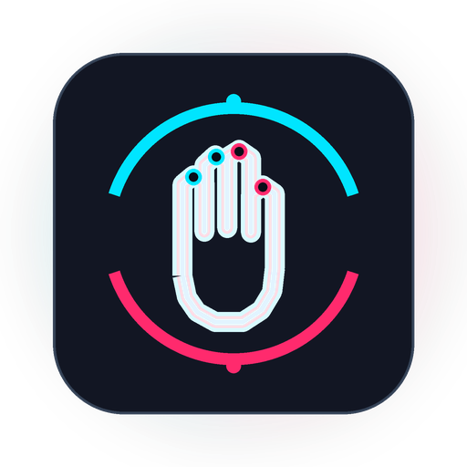
  <h1>Webcam Party Arcade</h1>
  <p>Six local mini-games for solo runs and same-device duels, powered by webcam-based MediaPipe tracking.</p>

  
  
  

  [Docs](#getting-started) · [Demo](https://webcam-party-arcade.teerananpakdeekhan.chatgpt.site/) · [Report Bug](https://github.com/01aptx01/minigame-with-mediapipe/issues/new?title=Bug%20report) · [Request Feature](https://github.com/01aptx01/minigame-with-mediapipe/issues/new?title=Feature%20request)
</div>

## Table of Contents

- [About](#about)
- [Features](#features)
  - [Screenshots](#screenshots)
- [Getting Started](#getting-started)
  - [Prerequisites](#prerequisites)
  - [Installation](#installation)
  - [Quick Start](#quick-start)
- [Usage](#usage)
- [Configuration](#configuration)
- [Roadmap](#roadmap)
- [Contributing](#contributing)
  - [Validation](#validation)
- [License](#license)
- [Acknowledgments](#acknowledgments)

## About

Webcam Party Arcade is a browser-based collection of six mini-games for one or two people sharing a device. Hand, pose, and face landmarks are processed in the browser with MediaPipe Tasks Vision. Webcam play is optional: each game has pointer, keyboard, or on-screen practice controls for trying it without camera tracking.

The 1v1 mode is local split-screen play; it does not use online matchmaking. Player names last for the current page session, while completed scores are stored in that browser's `localStorage`.

### Architecture

- `app/page.tsx` loads the arcade hub. `components/ArcadeApp.tsx` selects a game from the `?game=` query parameter.
- `contexts/MediaPipeContext.tsx` owns the shared camera stream and hand, pose, and face landmarker instances. The MediaPipe WebAssembly files are served from `public/mediapipe/wasm`; task model files are fetched from Google Cloud Storage when a model is initialized.
- Each game has a canvas/UI component in `components/` and game rules in `lib/games/<game>/`. Shared canvas, audio, session, and local scoreboard code lives in `lib/games/shared/`, `components/arcade/`, and `hooks/useArcadeSession.ts`.

## Features

- **Neon Slash Duel** — swipe through gems, avoid skull bombs, and send short glitches to the other player's half. 60-second rounds.
- **Pose Match Battle** — hold the prompted pose to score with 80%+ joint accuracy, dodge Fake-Outs, and compete for overdrive bonuses. The end card can show an MVP snapshot of the highest-scoring pose. 60-second rounds.
- **Rhythm Dodge** — lean and duck to avoid lasers on a 128 BPM beat. 60-second rounds.
- **Sorcerer's Duel** — cast Lightning, Reflect Shield, and Arcane Fist spells with hand gestures. Play solo against the Arcane Bot or in a 1v1 duel. 60-second rounds.
- **Neon Muncher** — open your mouth to catch snacks and close it to deflect bombs. A triggered Shame Cam moment can produce a downloadable snapshot in the end card.
- **Six Seven** — pump either wrist for a point on every lift as the numbers alternate 6 and 7 in a 30-second solo run. Webcam scores use a browser-local scoreboard; keyboard and touch practice scores stay separate and are not saved.
- **Solo and 1v1 modes** with editable player names. Names are trimmed and limited to 18 characters.
- **Browser-local scoreboards** retain up to eight entries per game; the end screen displays the top five and can clear that game's scores.
- **Camera-free controls** include pointer input, keyboard input, or on-screen buttons depending on the game. Denying camera permission or playing without a webcam leaves these practice controls available.
- **Generated sound effects** can be muted in the game HUD or with the `M` key.

### Screenshots

The screenshots were captured from the public demo using camera-free controls. The leaderboard includes three seeded sample entries and two actual demo game results.

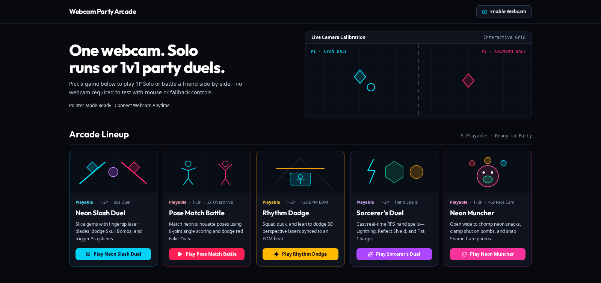

*The arcade hub links to all six games.*

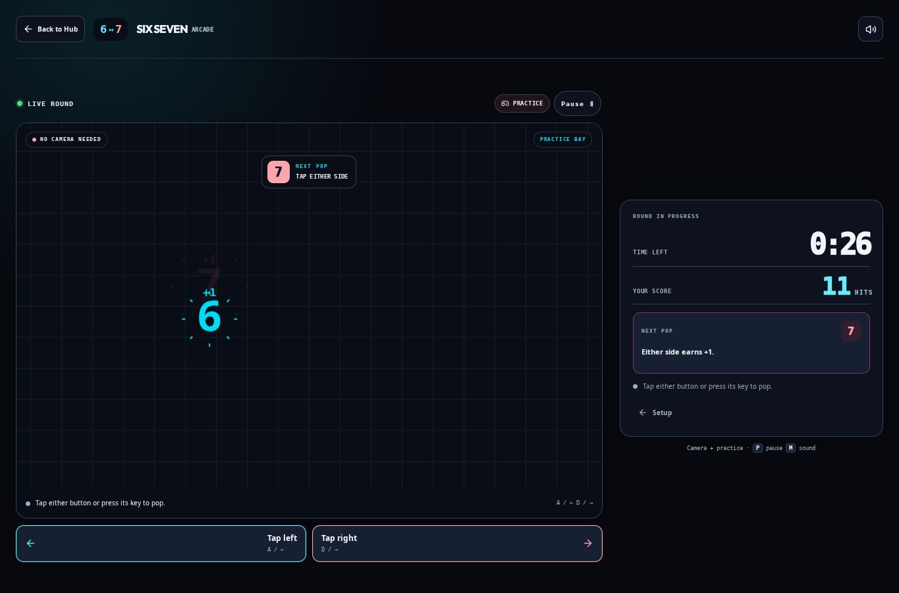

*Two correct switches light up the 6 and 7 effects. The HUD shows the score and the next move.*

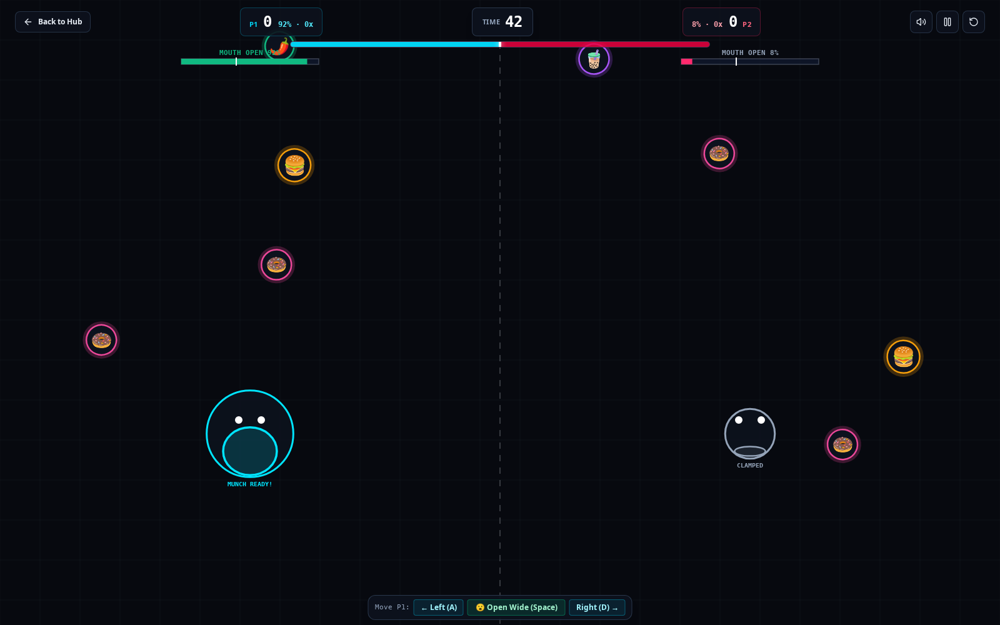

*Neon Muncher turns mouth-open and mouth-closed actions into arcade controls.*

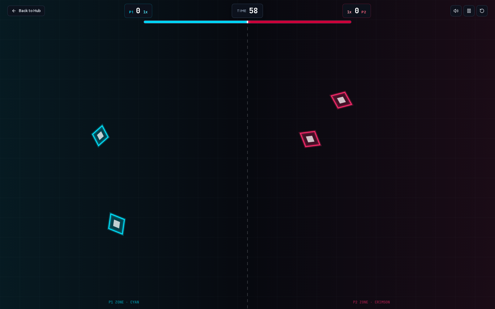

*Neon Slash Duel gives each player a side of the arena.*

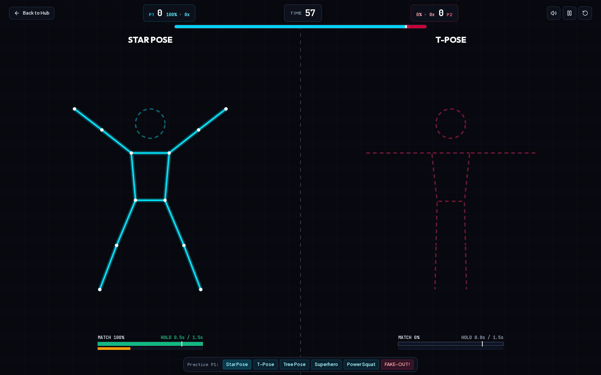

*Practice buttons let Player 1 try the pose-matching rules without a webcam.*

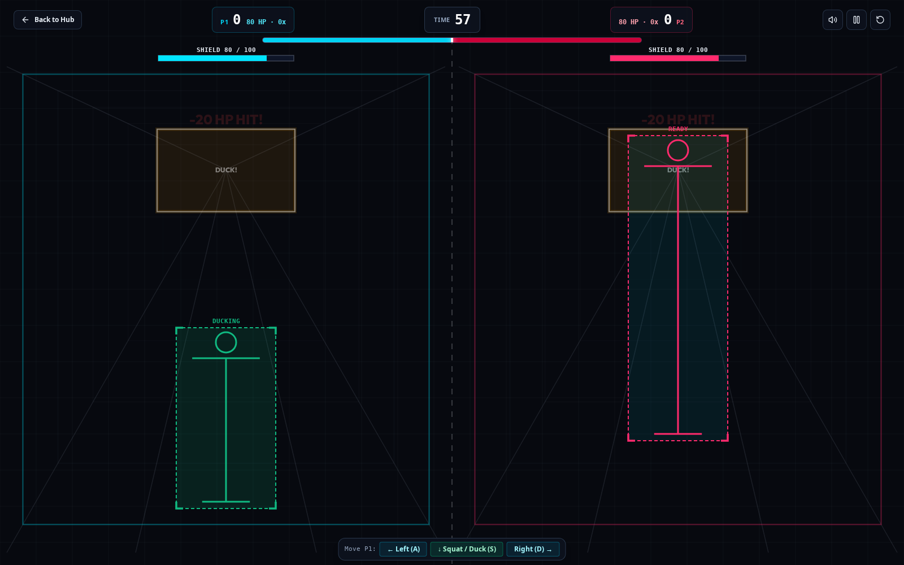

*Rhythm Dodge challenges players to move and duck around incoming lasers.*

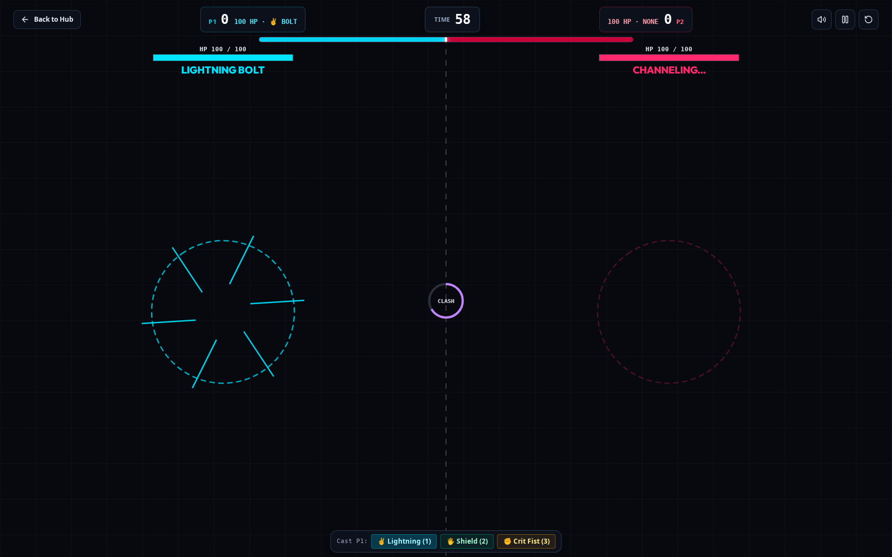

*On-screen buttons provide camera-free controls for Lightning Bolt, Reflect Shield, and Arcane Fist. Webcam play can cast spells with hand gestures.*

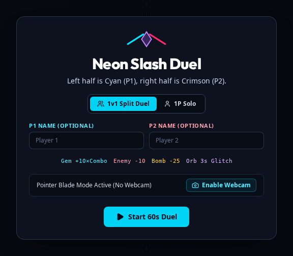

*Choose a mode, add optional player names, and enable the webcam or play with pointer input.*

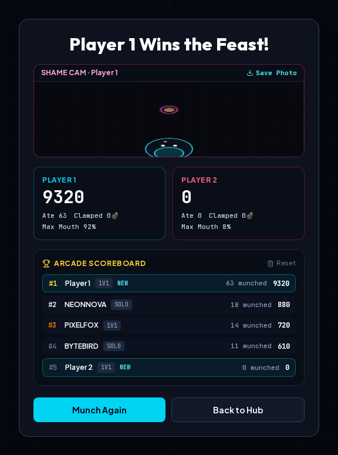

*The example scores on this Neon Muncher result card illustrate the browser-local scoreboard.*

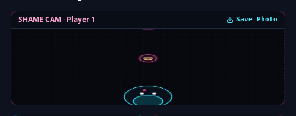

*This example was captured with camera-free fallback input. During webcam play, the rendered game canvas may include the live camera view; Shame Cam downloads a crop from that canvas.*

## Getting Started

### Prerequisites

- Node.js 24 LTS and npm to install dependencies and build the app.
- A modern browser with webcam support for MediaPipe tracking. Grant camera permission when prompted; the fallback controls work without a camera.
- The MediaPipe models and WebAssembly runtime files are included in the repository.

### Installation

```bash
git clone https://github.com/01aptx01/minigame-with-mediapipe.git
cd minigame-with-mediapipe
npm ci
```

### Quick Start

```bash
npm run dev
```

Open the local URL printed by Next.js (normally `http://localhost:3000`). Choose a game, click or tap Solo or 1v1, enter names if you like, and start a round. Select **Enable Webcam** to grant camera access, or use the game's fallback controls.

### Build for deployment

```bash
npm run build
```

Serve the generated `out/` directory with a static web server.

On a deployed site, serve the app over HTTPS for camera access. If it is embedded in an iframe, the host page must grant that frame camera permission.

## Usage

### Choose a game

The arcade hub links to each game. Most game pages let you choose Solo or 1v1 and set player names. A blank name uses `Solo Player`, `Player 1`, or `Player 2` by default. 1v1 is played on the same screen with each player's tracked hand, face, or body assigned to a side. Six Seven is solo-only and lets you choose camera play or practice controls.

### Six Seven

Open [Six Seven](https://webcam-party-arcade.teerananpakdeekhan.chatgpt.site/?game=six-seven). Choose **Camera**, enable the webcam, and move into view until at least one wrist is marked. After the countdown, lift either wrist to earn **+1**, lower it to reset, and lift again. You can repeat with the same wrist or alternate hands. The pop numbers alternate **6** and **7** in every 30-second solo round. Completed camera rounds appear on the scoreboard in that browser.

Turn on **Save my camera runs** before starting a camera round to capture the game view with your camera, wrist markers, hit effects, and score. Open **Clips** to watch, scrub, download, or delete your recent recordings. Six Seven keeps up to five completed clips in this browser and requests no microphone access. Clip recording uses browser media APIs and is optional.

Choose **Practice** to use the on-screen buttons or a keyboard. Press `A`, `D`, `←` or `→`, or tap either pad. Each discrete press or tap earns one point. Practice scores appear on the result screen for that round.

### Camera and fallback controls

The app requests a front-facing camera with 1280×720 as the ideal resolution and no audio. Tracking runs against the browser's video stream. Hand tracking supports up to four hands; pose and face trackers each support up to two people. The shared game trackers try GPU inference first and fall back to CPU. The shared pose tracker also falls back from the full model to the lite model. Six Seven uses a dedicated one-person Pose Lite tracker. It processes fresh video frames in a worker when supported, using direct frame transfer where available. The tracker falls back to bitmap sampling or the main thread as needed.

If camera permission is denied or no webcam is available, each game exposes a fallback. The available fallback inputs are:

| Game | Camera-free controls |
| --- | --- |
| Neon Slash Duel | Move a mouse or touch pointer across the canvas to create a blade; press and drag also works. |
| Pose Match Battle | Player 1 can press and hold a pose button shown below the game canvas. |
| Rhythm Dodge | Player 1: `A`/`D` to move and `S` to duck (arrow keys also work). Player 2: `J`/`L` to move and `K` to duck. On-screen buttons control Player 1. |
| Sorcerer's Duel | Player 1: `1`/`2`/`3` or `Q`/`W`/`E`; Player 2: `7`/`8`/`9`. On-screen buttons control Player 1. |
| Neon Muncher | Player 1: `A`/`D` to move, `W` or `Space` to open, and `Q`/`E` to tilt. Player 2: left/right/up arrows. On-screen buttons control Player 1. |
| Six Seven | Practice: `A`, `D`, `←`, `→`, or either on-screen pad earns one point per press. |

### Round controls

- `Enter` or `Space` starts from the title screen.
- `P` or `Esc` pauses or resumes a round.
- `M` toggles sound effects.
- `R` restarts the current round.
- The same actions are available from the game HUD.

Use mouse or touch to choose Solo or 1v1; `Enter` and `Space` start the round rather than selecting a mode.

Most games run for 60 seconds; Neon Muncher runs for 45 seconds and Six Seven runs for 30 seconds. The end screen shows the result and local scoreboard. Six Seven adds webcam runs to its browser-local scoreboard; practice results are kept only for the current run. Pose Match can show an MVP snapshot, and Neon Muncher can show a Shame Cam snapshot with a Save Photo link. These snapshots are captured from the game canvas, which can include the live camera view during webcam play.

## Configuration

Game tuning values such as round duration, scoring, and detection thresholds are source constants under `lib/games/`; there is no settings panel for changing them.

| Setting | Default or behavior |
| --- | --- |
| Camera capture | Front-facing video; 1280×720 ideal dimensions; audio disabled. |
| Hand tracker | Up to 4 hands; attempts GPU, then CPU. |
| Pose tracker | Up to 2 poses; full model with lite-model fallback; attempts GPU, then CPU. |
| Face tracker | Up to 2 faces; attempts GPU, then CPU. |
| Score storage | Browser `localStorage`, separate key per game; up to 8 saved entries. |
| `DISABLE_HMR` | Set to `true` in development to disable file watching, as used by the AI Studio environment. Restart the dev server after code changes when this is enabled. |

`.env.example` lists `GEMINI_API_KEY` and `APP_URL` as AI Studio host-injected values. The game source does not read either variable, so neither is required for local play. There are no game-specific public environment variables.

## Roadmap

Ideas for future work, not committed delivery dates:

- Add a retry path for model-load failures and keep the fallback controls visible when a tracker fails after camera permission succeeds.
- Align the camera preview, landmark projection, and game input transforms across screen sizes.
- Add continuous integration and browser smoke tests for permission and game-start flows.

## Contributing

Small fixes and game ideas can be proposed through a GitHub issue or pull request. For gameplay changes, keep deterministic rules in the relevant `lib/games/<game>/engine.ts` module and add or update its unit tests. Run the checks below before submitting a change.

### Validation

```bash
npx --yes bun test
npm run lint
npm run build
```

The repository includes Node.js `node:test` unit tests for game engines, camera access, and scoreboard logic. `npx --yes bun test` runs those suites. The build configuration skips ESLint, so run `npm run lint` separately.

## License

This repository does not currently include a `LICENSE` file.

## Acknowledgments

- [MediaPipe Tasks Vision](https://ai.google.dev/edge/mediapipe/solutions/guide) for browser-side hand, pose, and face landmark tracking.
- [Next.js](https://nextjs.org/) and [React](https://react.dev/) for the web application framework and UI.
- [Bun](https://bun.sh/) for the test runner.
